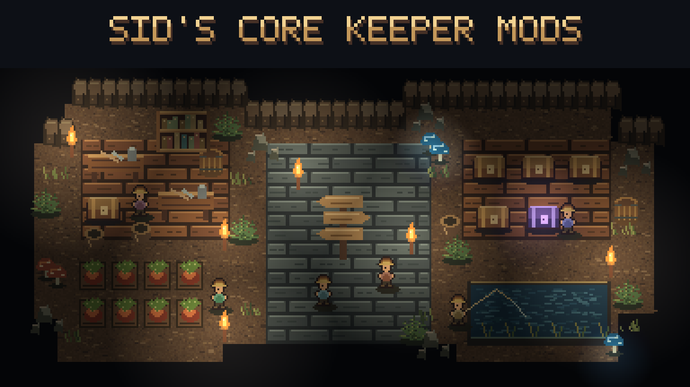

# Sid's Core Keeper mods

Make Core Keeper fit the way you like to play: spend less time on chores, customize your equipment, or adjust the challenge. Each mod page explains what changes, how to use it, and what you need to install.

## Choose how to install

- **One package:** [Sid's Overhaul on Steam Workshop](https://steamcommunity.com/sharedfiles/filedetails/?id=3813043354). Includes the features below and the Mod Options menu. Subscribe to CoreLib too.
- **Pick individual mods:** [Sid's Core Keeper Mods collection](https://steamcommunity.com/sharedfiles/filedetails/?id=3814775238). Choose the mods you want and subscribe to their required items.
- **Manual download:** [Latest GitHub release](https://github.com/Sthakur27/corekeeper-mods/releases/latest). Follow the release's install steps and the zip's README.txt. The published release may be older than the source in this repository.

Use the Overhaul or the individual versions of its features. Installing both runs the same features twice. Restart Core Keeper after installing or updating mods. For multiplayer, check each mod's requirements and use matching versions on the host and clients.

**Golden Chance is still a work in progress.** Its artwork and documentation are marked WIP; they do not mean the feature is finished. It is also included in the Overhaul. You can switch it off under **Settings > Mod Options > Turn Sub-Mods On/Off**, then restart.

## Find a mod

### Inventory and appearance

| Mod | What it helps with |
|---|---|
| [Loadout Fallback](LoadoutSharing/README.md) | Reuse equipment in empty loadout slots and keep separate vanity outfits. |
| [Five Loadouts](FiveLoadouts/README.md) | Add two more equipment loadouts. Requires Loadout Fallback. |
| [Ender Stash](EnderStash/README.md) | Access your character's personal 40-slot stash through an Ender Chest. |
| [Armor Dye](ArmorDye/README.md) | Color individual armor pieces, weapons and tools. |
| [Pet Editor](PetEditor/README.md) | Change a pet's level, talents and color. |

### Farming, fishing and supplies

| Mod | What it helps with |
|---|---|
| [Auto Replant](AutoReplant/README.md) | Replant harvested crops using seeds you carry. |
| [Bigger Watering Cans](BiggerWateringCans/README.md) | Water larger patches of soil at once. |
| [Faster Mushrooms](FasterMushrooms/README.md) | Adjust spread and mushroom regrowth near players. |
| [Fast Auto Fishing](FastAutoFishing/README.md) | Automate fishing and shorten the wait between catches. |
| [Better Fishing Loot](BetterFishingLoot/README.md) | Adjust the odds of fishing up valuable non-fish loot. |
| [Potion Seller](PotionSeller/README.md) | Buy potions, explosives and Titan summon items from merchants. |
| [Fish Seller](FishSeller/README.md) | Buy fish and Shiny Larva Meat; scroll through expanded shops. |
| [Merchant Restock](MerchantRestock/README.md) | Choose how quickly merchants refill their stock. |
| [Infinite Ore Boulders](InfiniteOreBoulders/README.md) | Keep drilling ore boulders without using them up. |

### Combat, travel and progression

| Mod | What it helps with |
|---|---|
| [Quick Buff](QuickBuff/README.md) | Use shortcuts for buff food, potions and healing. |
| [Buff Duration Floor](BuffDurationFloor/README.md) | Set a minimum duration for short food and potion buffs. |
| [Durability Multiplier](DurabilityMultiplier/README.md) | Choose how quickly equipment wears out. |
| [Difficulty Tuning](DifficultyTuning/README.md) | Tune enemies and bosses separately for Normal and Hard worlds. |
| [Boss Bonus Loot](BossBonusLoot/README.md) | Add extra rewards to selected bosses and enemies. |
| [Skill XP Multiplier](SkillXPMultiplier/README.md) | Adjust experience gains separately for each skill. |
| [Keep Minions On Teleport](KeepMinions/README.md) | Bring summoned minions along when you teleport. |
| [Vehicle Speed](VehicleSpeed/README.md) | Change boat and go-kart speeds. |
| [Hit Sound Effects](StimHits/README.md) | Choose sounds for hits, kills and damage taken. |
| [Golden Chance — WIP](GoldenChance/README.md) | Golden crop and food-rarity bonuses, with an optional rarity roll for main dishes. |

### Settings and the full package

- [Mod Options](ModOptions/README.md) puts supported mod settings in one in-game menu. It also discovers compatible third-party CoreLib client settings; not every mod or setting is supported. Individual mod pages list their required dependencies.
- [Sid's Overhaul](Overhaul/README.md) combines the mods above, with Mod Options built in.

## Source, credits and artwork

Each folder contains its mod's source and documentation. Credits and license details are kept on the individual pages; Fast Auto Fishing is a mikufish fork, and the Overhaul uses GPL-3.0-or-later. Listing artwork lives in `release/`; older artwork scripts are retained there too.

`release/build_overhaul.py` assembles the combined package.
