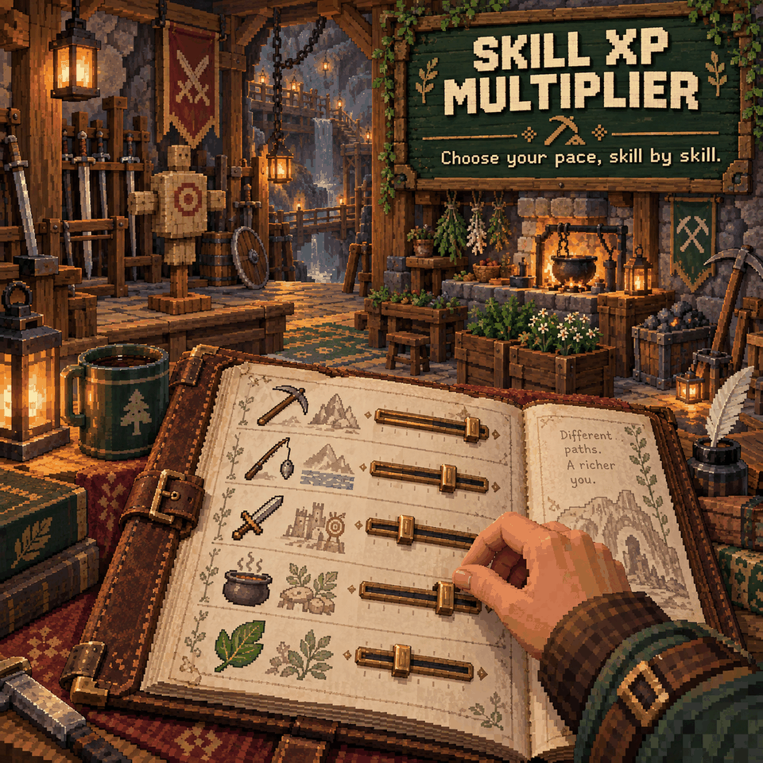

# Skill XP Multiplier

Choose how quickly each skill levels up. Speed up the skills you find slow, slow down others, or pause XP gains entirely.

## Set your pace

Open **Settings > Mod Options > Skill XP Multiplier** and choose a multiplier for each skill. All skills start at **1x**, the normal game rate.

- **0x** pauses new XP for that skill; it does not remove earned levels.
- **0.25x–0.75x** slow progress down.
- **1.5x–100x** speed it up, using the menu's preset choices.

Supports Mining, Running, Melee, Vitality, Crafting, Range, Gardening, Fishing, Cooking, Magic, Summoning and Explosives. Changes apply to newly earned XP immediately and save automatically.

## Chat shortcuts

- `/xp` — show every multiplier.
- `/xp mining 20` — set Mining to 20x.
- `/xp all 1` — restore every skill to the normal rate.

Commands choose the nearest supported multiplier. This changes XP earned from playing; it does not directly set skill levels.

## Requirements and compatibility

Requires **CoreLib** and **Mod Options**. Install, then restart Core Keeper. The loader does not require matching installations across multiplayer participants; settings are stored locally rather than synchronized by this mod.

Disable the other **XP Multiplier** mod if installed: its multiplier can stack with this one and produce much larger gains than intended.
