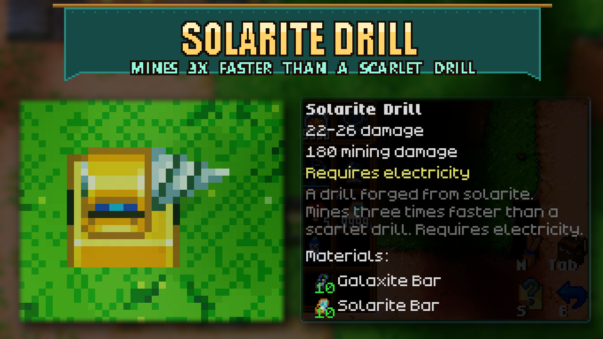

# Solarite Drill

A stationary drill one tier above the Scarlet Drill. Craft it for **10 Galaxite Bars + 10 Solarite Bars** at the **Solarite Workbench** (Crafting tab, next to the Solarite Anvil). Higher-tier benches that include Solarite recipes can craft it too.

It works exactly like the vanilla drills: place it facing any of the four directions, power it with electricity, and it mines the block in front of it and pushes items along like the other drills. It deals **3x the Scarlet Drill's mining damage** (180 per hit instead of 60), so it breaks blocks about three times as fast. On ore boulders the game slows down very fast drilling, so a single Solarite Drill gets roughly 2.5x the ore of a Scarlet Drill. It has its own gold Solarite look, based on the Tin and Scarlet drill sprites.

No settings and no library dependencies. Install on both the host and clients in multiplayer.

## Install

Subscribe to the Workshop item, or extract the manual archive into `CoreKeeper_Data/StreamingAssets/Mods/SolariteDrill` so `ModManifest.json` sits directly inside that folder. Restart Core Keeper. Existing Solarite Workbenches gain the recipe automatically. Do not run the standalone version alongside an Overhaul version that already includes Solarite Drill.

The recipe uses an empty slot in the Solarite Workbench Crafting tab without replacing other recipes. If another mod fills all four empty slots there, this mod leaves those recipes intact and cannot add its own.

Pick up placed Solarite Drills and remove them from inventories and storage before uninstalling the mod.

## Development

- `python -I SolariteDrill/Unity/make_art.py`: regenerate the sprites (and `Art/preview.png`) from the vanilla Tin/Scarlet drill sheets and Solarite palette exported by `extract_reference.py`.
- `python -I SolariteDrill/Unity/dump_vanilla.py`: re-dump the vanilla Scarlet Drill prefabs into `vanilla_drill.json` after a game update.
- `python SolariteDrill/Unity/build_bundle.py`: build the Windows/Linux bundles with Unity 6000.0.59f2 and the official Mod SDK, then run `verify_bundle.py`.
- `python SolariteDrill/Unity/compile_check.py`: compile the runtime scripts against the local game assemblies.

How it is put together: four entity prefabs (`SolariteDrill_<Direction>Entity`, variations 0-3) copy the vanilla Scarlet Drill prefabs and use the vanilla drill graphics. Two `SpriteAssetSkin` data blocks target the vanilla drill sprite assets the same way the Tin Drill's skins do, and `DrillReskinPatch` applies them for this object. Every networked prefab carries the `SolariteDrill_` prefix so its ghost type never collides with a vanilla prefab's.
