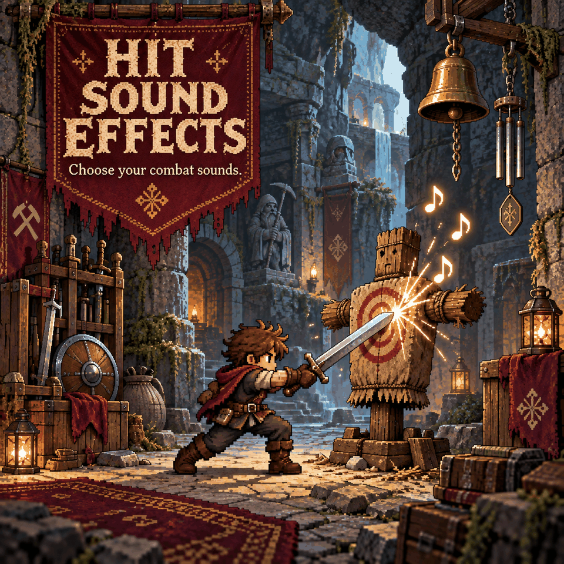

# Hit Sound Effects

**Hear hits, kills and damage more clearly** with separate sounds: a ting when you hit a creature, a coin "cha-ching" when a recently hit creature dies, and a clang when you take damage. The vanilla sounds they replace are muted.
Open **Settings > Mod Options > Hit Sound Effects** to choose sounds and adjust each volume and pitch; set a slot to **Off** for the vanilla sound.

Previously named **Stim Hits**. Existing settings and custom sound files carry over; the internal folder remains `StimHits`.

| Option | Default | |
|---|---|---|
| Hit sound / volume / pitch | Auto / 0.8 / 1.0 | You damage a creature (melee, bow, gun, staff). |
| Kill sound / volume / pitch | Auto / 0.9 / 1.0 | A creature you hit in the last 1.5 s dies. |
| Hurt sound / volume / pitch | Auto / 0.9 / 1.0 | You take damage. |
| Hit range (tiles) | 16 | Creatures' vanilla hurt sounds are muted within this range (objects ding within it). |
| Ding on objects too | Off | Also ding on ore boulders, destructibles etc. while you are attacking (drills and other players hitting nearby objects stay vanilla) |

Sounds: **Auto** (your own hit/kill/hurt file if present, else the built-in sound for that slot),
**Ting**, **Clang**, **Coin** (the mod's own synthesized sounds), **Game Clang / Small Clang / Ding /
Anvil / Bell / Shield** (Core Keeper's sounds), then **every sound file in your sounds folder**, listed
by file name, so you can cycle through them in the menu.

## Your own sounds

Put `.mp3`, `.ogg` or `.wav` files (subfolders are fine) in

    %USERPROFILE%\AppData\LocalLow\Pugstorm\Core Keeper\Steam\<your id>\mods\StimHits\Sounds
The folder is created on first launch. Every file shows up by name in all three sound choices after
a restart. Files named `hit`, `kill` or `hurt` in the folder itself are what **Auto** plays; add
numbered variants (`kill2`, `kill3`, ...) and a random one plays each time. The folder lives outside
the mod, so updates never touch it and your files are never shared with anyone. Keep sounds short
(under a second). Silence at the start of a file is cut automatically so sounds land on the hit.

## Limits

- Hits are attributed through the damage numbers: your melee and your own projectiles count; pets,
  minions and other players do not. Their creature-hurt sounds are still muted within the range.
- Replaced: the creature's hurt sound, the melee impact sound and the impact sound of your
  projectiles that hit. Flash, particles and enemy death sounds stay vanilla.
- Sound playback is local: other players hear their own settings. The manifest requires the mod on both client and server for multiplayer.

Requires CoreLib and Mod Options. Built into Sid's Overhaul.
