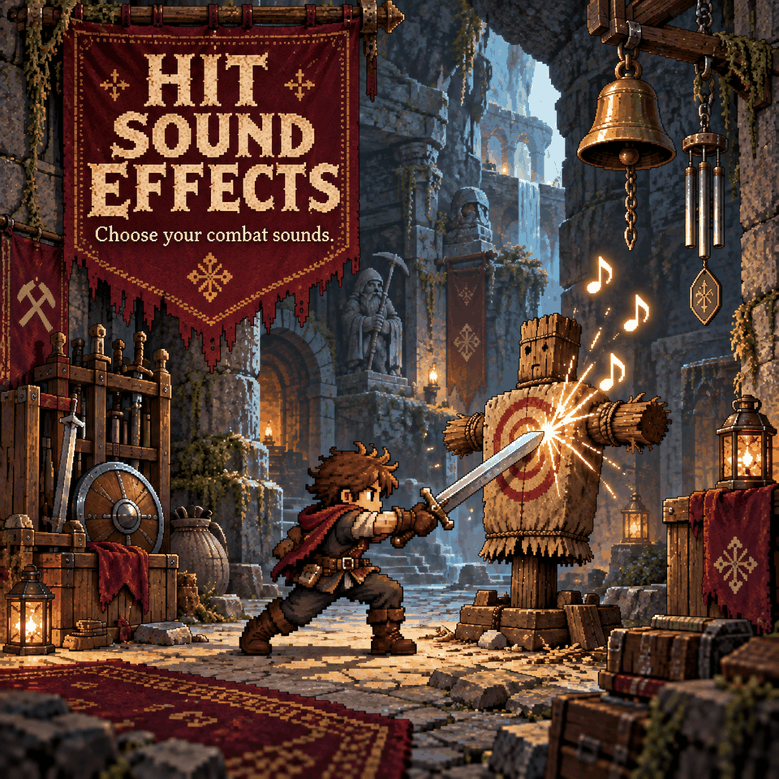

# Hit Sound Effects

Hit Sound Effects plays a ting when you damage a creature, a coin sound when a creature you recently hit dies, and a clang when you take damage. You can choose a different sound for each, adjust their volume and pitch, or use your own audio files.

Open **Settings > Mod Options > Hit Sound Effects** to change the sounds. Set a sound to **Off** to leave that part of the game's audio unchanged.

## Settings

All three sounds start on **Auto**. Without custom files, this uses Ting for hits, Coin for kills and Clang when you get hurt.

- **Hit volume** starts at 0.8; **Kill volume** and **Hurt volume** start at 0.9. Each ranges from 0.1 to 1.0.
- Each sound's **pitch** starts at 1.0 and ranges from 0.5 to 2.0. The game's sound effects volume also applies.
- **Hit range (tiles)** starts at 16 and ranges from 2 to 30. Creature hurt sounds are muted within this range when replacement hit sounds are enabled. Optional object dings also use this range.
- **Ding on objects too** starts off. Turn it on for ore boulders and other destructible objects while you are attacking. Nearby drills and other players hitting objects keep their normal sounds.

Besides **Off** and **Auto**, you can choose the mod's **Ting**, **Clang** or **Coin**, or the game's **Game Clang**, **Game Small Clang**, **Game Ding**, **Game Anvil**, **Game Bell** or **Game Shield**. Your custom files appear by name in the same choices.

## Your own sounds

The mod creates this folder on first launch:

    %USERPROFILE%\AppData\LocalLow\Pugstorm\Core Keeper\Steam\<your id>\mods\StimHits\Sounds

Put `.mp3`, `.ogg` or `.wav` files there, then restart the game. Subfolders are supported, and each file appears by name in all three sound choices.

For **Auto**, put files named `hit`, `kill` or `hurt` directly in the Sounds folder, with one of the supported extensions. You can add numbered variants such as `kill2.wav` and `kill3.wav`; Auto chooses randomly from that sound's files each time. If there are no custom files for a sound, Auto uses its built-in sound.

Keep clips short, ideally under a second. Leading silence is trimmed automatically so the sound lines up with the hit. These files live outside the installed mod, so updates leave them alone. They stay on your computer and are not shared with other players.

Previously called **Stim Hits**. Existing settings and custom sounds carry over; the folder is still named `StimHits`.

## What counts as a hit or kill

Your melee attacks and your own bow, gun and staff projectiles count. Hits are identified through damage numbers, so pets, minions and other players do not trigger your replacement hit sound. A creature must die within 1.5 seconds of your hit to trigger the kill sound.

The replacement hit sound mutes the creature hurt sound, melee impact sound and the impact sound of your projectiles that hit. Creature hurt sounds from pets, minions and other players are also muted within the configured range, even though those attacks do not trigger a replacement. Flashes, particles and enemy death sounds stay unchanged.

## Requirements and multiplayer

Requires **CoreLib** and **Mod Options**. This feature is also included in **Sid's Overhaul**; use either the standalone mod or the bundle.

Sounds and settings are local: other players hear their own choices. Multiplayer requires the mod on both the client and server.

Cover artwork generated with AI; not an in-game screenshot.
