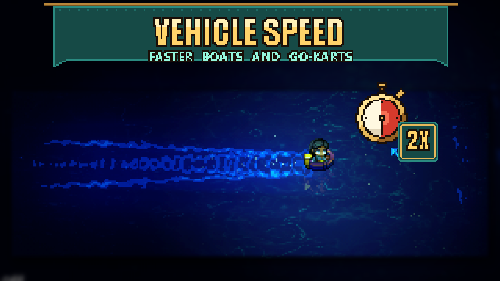

# Vehicle Speed

Vehicle Speed makes boats and go-karts faster, with a separate setting for each. Both start at **1.5x** normal speed. You can turn either one back to **1x** or raise it as high as **10x**.

Open **Settings > Mod Options > Vehicle Speed** to change **Boat speed** or **Go-kart speed**. Both offer the same choices: **1x, 1.25x, 1.5x, 1.75x, 2x, 3x, 5x and 10x**.

Changes apply while you play, including to boats and karts you already have. Primitive, Renegade and Speeder go-karts are all included. Steering stays at normal speed, so faster karts take wider turns.

Install **Vehicle Speed, CoreLib and Mod Options** on the host and every client. In multiplayer, everyone should use the same speed settings as the host. Avoid combining vehicle-speed changes from multiple mods, as their settings can conflict.

Cover is an in-game screenshot of a boat crossing open water (HDR capture tone-mapped); title banner and a stopwatch icon added.
