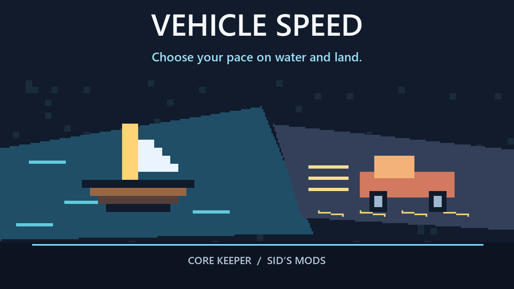

# Vehicle Speed

Spend less time travelling: choose separate speed boosts for **boats and go-karts**. Both start at normal speed, so you decide how fast to go.

## Choose your speed

Open **Settings > Mod Options > Vehicle Speed**.

| Setting | Choices | Default |
|---|---|---|
| Boat speed | 1x, 2x, 3x, 5x, 10x | 1x (normal) |
| Go-kart speed | 1x, 2x, 3x, 5x, 10x | 1x (normal) |

Changes apply while you play to existing boats and karts. This includes Primitive, Renegade and Speeder go-karts.

## Requirements and limits

Requires **CoreLib and Mod Options** on the host and every client. In multiplayer, everyone should choose the same values as the host.

Steering stays at normal speed, so fast karts take wider turns. Disable Boat Turbo or other mods that also change vehicle speeds to avoid conflicting settings.
