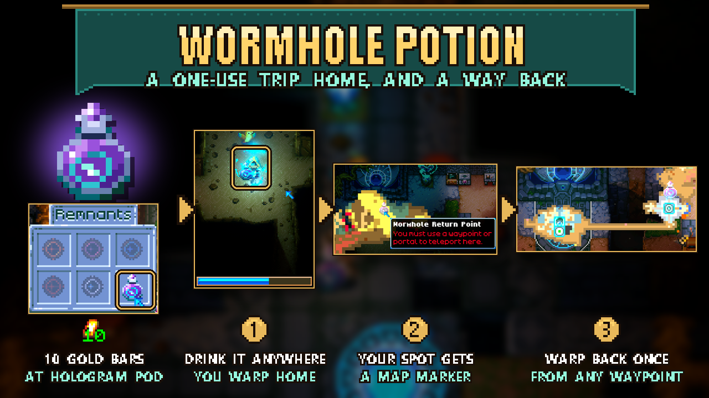

# Wormhole Potion

A one-use way home that also gets you back. Craft a **Wormhole Potion** for **10 Gold Bars** at an **Ancient Hologram Pod**.

Use it like a Recall Idol: after a three-second cast you teleport to the Core and the potion is used up. The spot where you drank it is marked on your map with the potion icon (**Wormhole Return Point**). Stand on any active waypoint, open the map and click that marker to teleport back, exactly like teleporting between waypoints. The marker disappears after that one trip.

- Moving, switching items or taking enough damage interrupts the cast, just like a Recall Idol. The potion is only used up when the cast finishes.
- Drinking within 12 tiles of the Core takes you home but leaves no marker.
- Drinking another potion in the same session replaces your previous marker. Markers from other players or earlier sessions stay until someone uses them.
- Any player can use any return marker.
- Return markers are saved with the world.

Tested in single player: crafting, drinking, the map marker and the trip back (the marker is removed after use). Multiplayer and keeping a marker across a save and reload have not been tested yet.

No settings and no library dependencies. Install on both the host and clients in multiplayer.

## Install

Subscribe to the Workshop item, or extract the manual archive into `CoreKeeper_Data/StreamingAssets/Mods/WormholePotion` so `ModManifest.json` sits directly inside that folder. Restart Core Keeper. Ancient Hologram Pods already in your world gain the recipe automatically. Do not run the standalone version alongside an Overhaul version that already includes Wormhole Potion.

The recipe uses the pod's empty recipe slot. If another mod has already filled it, this mod leaves that recipe alone and cannot add its own.

Use your return markers and remove potions from inventories and storage before uninstalling the mod.

## Development

- `python -I WormholePotion/Unity/make_art.py`: regenerate the potion icon.
- `python -I WormholePotion/Unity/dump_vanilla.py`: re-dump the vanilla waypoint map marker and Recall Idol prefabs into `vanilla.json` after a game update.
- `python WormholePotion/Unity/build_bundle.py`: build the Windows/Linux bundles with Unity 6000.0.59f2 and the official Mod SDK, then run `verify_bundle.py`.
- `python WormholePotion/Unity/compile_check.py`: compile the runtime scripts against the local game assemblies.

How it is put together: the potion is a cast item with the Recall Idol's cast values. `PotionCastSystem` runs before vanilla's Burst player-state systems in both predicted worlds and requests vanilla's teleport state. On the server it consumes the potion and spawns the return marker (`WormholePotion_MarkerEntity`), a copy of the vanilla waypoint map marker that, unlike the vanilla one, is saved with the world. The map treats it as a waypoint, so the vanilla map UI sends the teleport. `ReturnMarkerSystem` (server) keeps markers active and removes one when a player's teleport targets it. `MarkerIconPatch` draws it with the potion icon.
